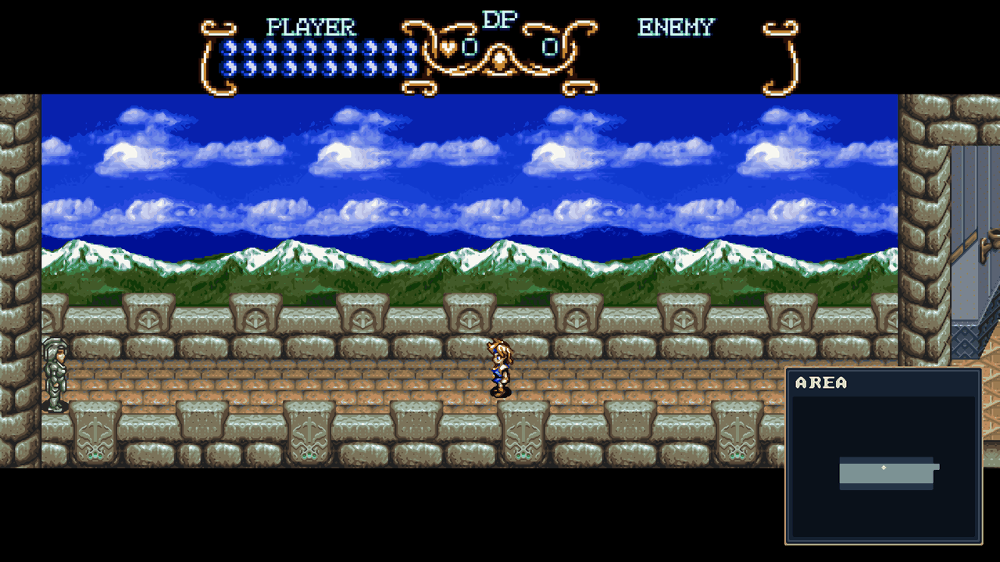
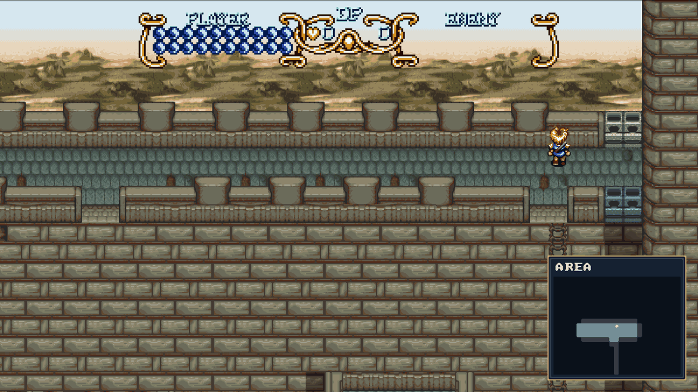
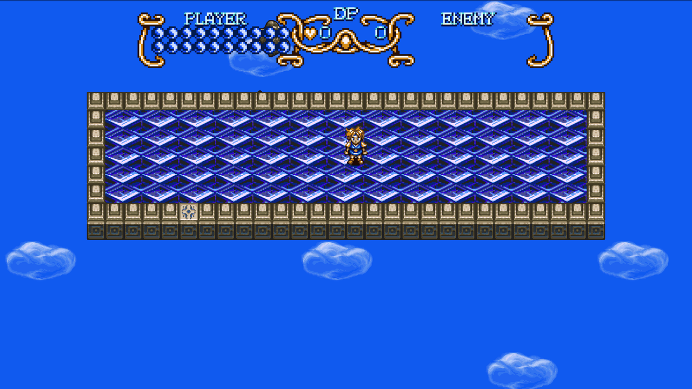
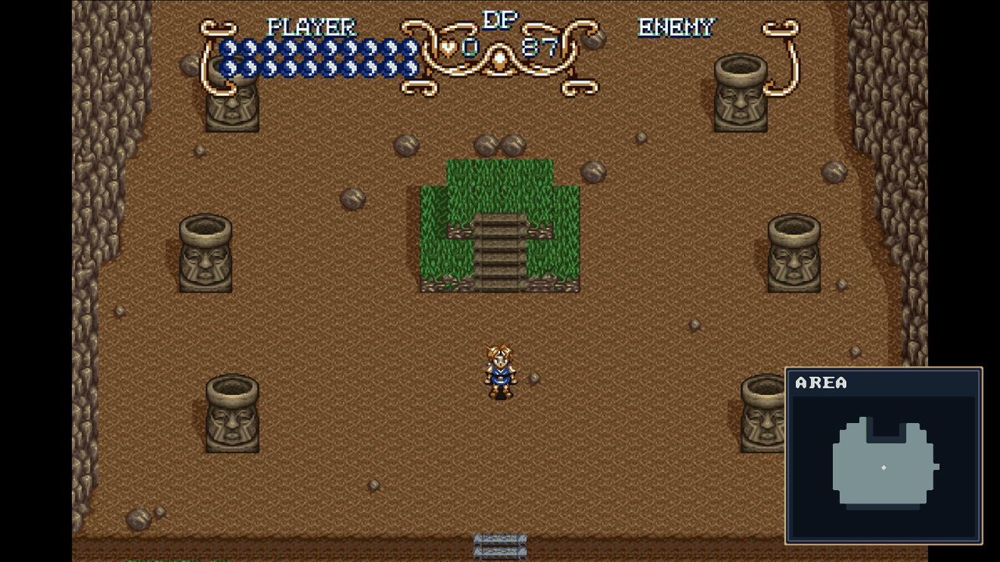
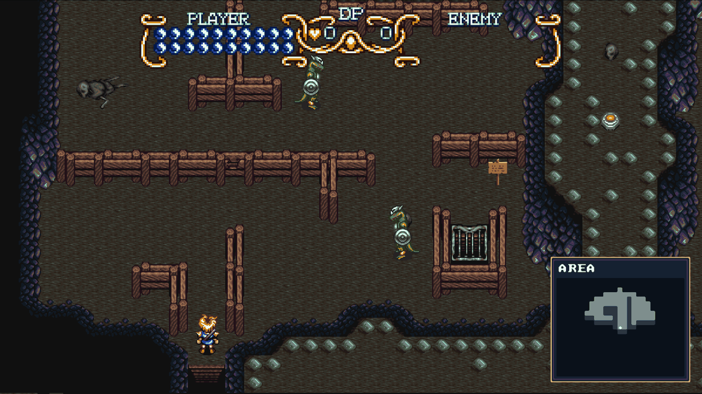
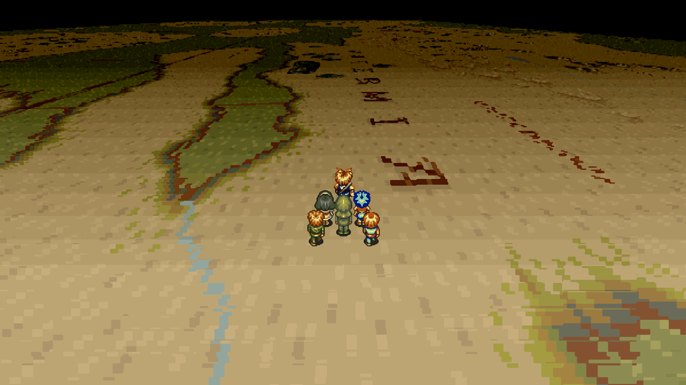
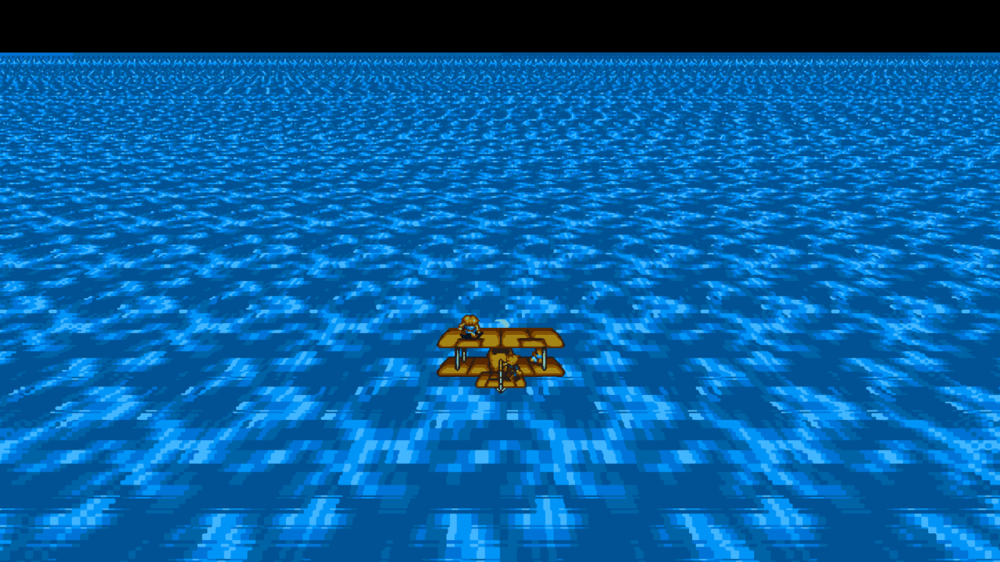
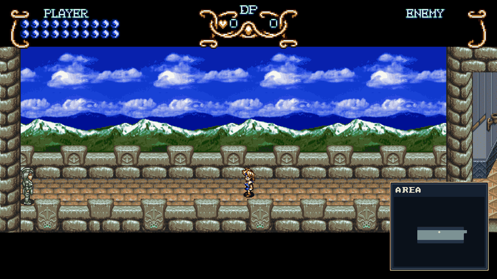
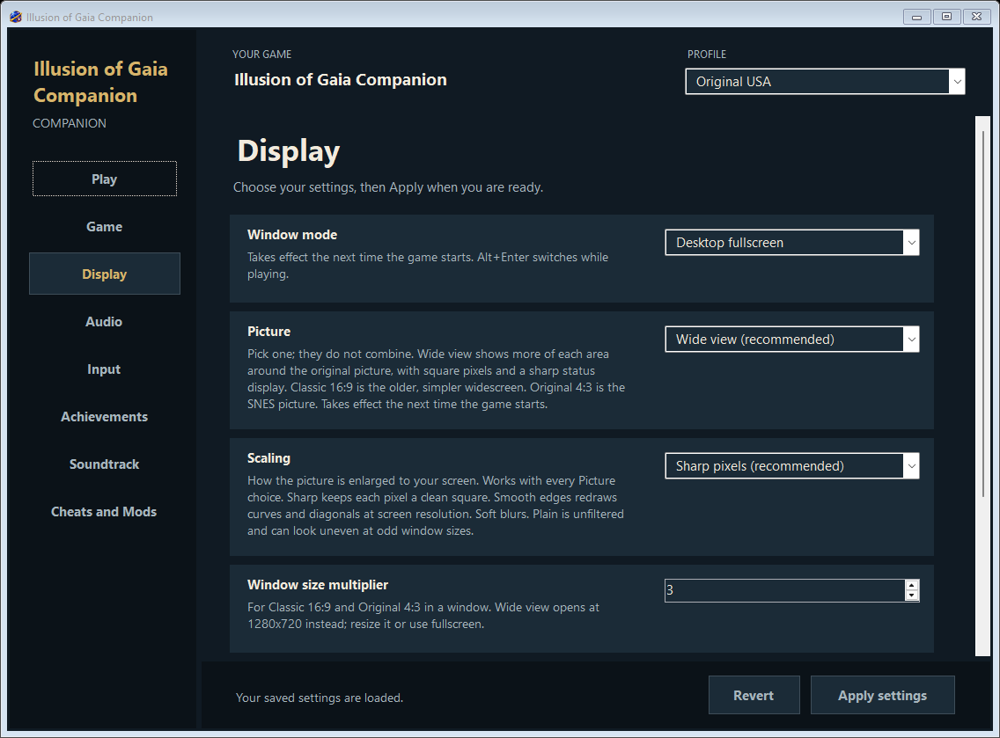
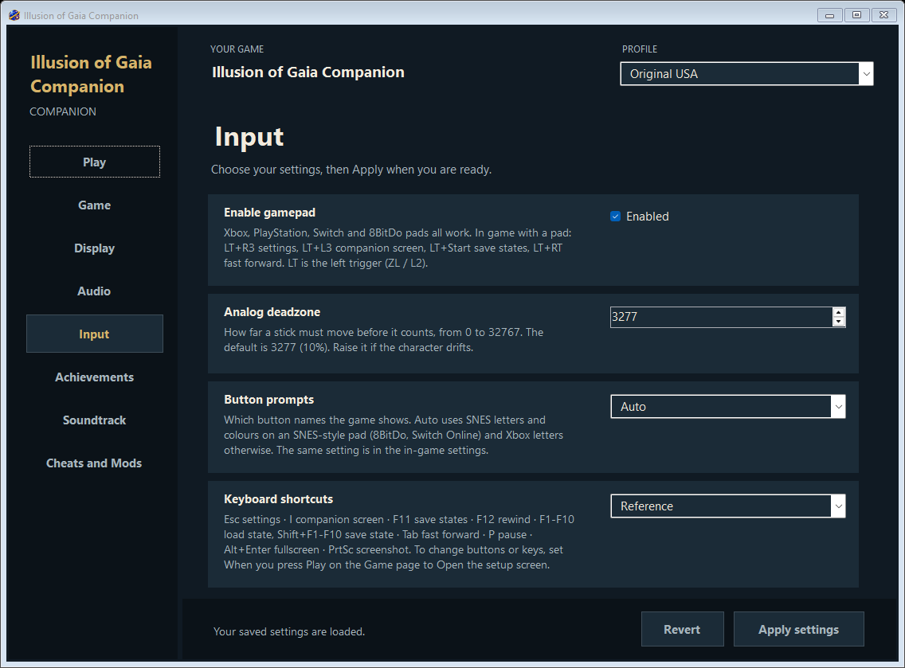

# Illusion of Gaia Companion

Quintet's 1993 SNES adventure as a modern PC release: the game recompiled to
native code, a true widescreen view drawn from the game's own scenery, an
area map that fills in as you explore, a walkable world map, the GaiaLabs
retranslation, achievements and optional orchestral MSU-1 music.

[Features](#features) · [How to play](#how-to-play) · [Development status](#development-status) ·
[Build from source](#build-from-source) · [Credits](#thanks)

**Windows test builds are on the
[Releases page](https://github.com/rages4calm/babel-recomp-companion/releases).**
They are pre-releases for playtesting; please
[report what you find](https://github.com/rages4calm/babel-recomp-companion/issues).
Bring your own unmodified **Illusion of Gaia (USA)** ROM; no game data is
included. Maintained by
[Carl Prewitt Jr. / rages4calm](https://github.com/rages4calm), based on
[Babel Recomp](https://github.com/mrOt4/babel-recomp) by mr0ta / mrOt4.



## Features

### A wider world, from the game's own art

The wide view shows about one and a half times the original screen in each
direction, with square pixels, using the scenery the game already has beyond
the edges of the original frame. Parallax skies, Mode 7 floors and boss rooms
keep working at the wider size. Screens made for the original width (title,
menus, a few story scenes) keep their original framing.

| The Great Wall | Sky Garden |
| --- | --- |
|  |  |
| **Inca Ruins** | **Diamond Mine** |
|  |  |

### Mode 7 in the wide view

The world map, the flight over the ocean and the other Mode 7 scenes fill
the wide view. The walkable world map's ground is drawn by the GPU at your
window's resolution; the others use the optional HD Mode 7 setting.

| Walkable world map | Flight over the ocean |
| --- | --- |
|  |  |

### Maps, music, achievements

- **Area map and radar.** Press **Start** wherever an area has a map: a
  scenery-based map that reveals as you explore, with exits and chests. A
  small radar sits in the corner while you play.
- **Walkable world map** from the GaiaLabs project, with an enhanced view:
  higher camera, place markers and a minimap.
- **GaiaLabs Retranslation**, included: 1,133 retranslated dialogue entries,
  all 124 approved menu strings and all 64 named room titles.
- **Achievements**, saved on your PC, with a controller-friendly browser in
  the in-game settings.
- **Optional MSU-1 orchestral soundtrack**, imported and verified on the
  launcher's Soundtrack page. The original SNES music is the default.
- **Conveniences you can switch on:** auto-run (walk to build speed; hold the
  run button to start sooner) or hold to run, a text speed setting with the
  run button to hurry any line, using key items by pressing A on their
  spot, a twinkle over each Red Jewel still to be found, hold to advance
  dialogue,
  item stacking, quick item selection, an equipped-item marker, a status
  display at the screen edges, and save states with a confirmation before
  anything is overwritten.
- **Companion Launcher** for picture, scaling, audio, controller, cheats and
  mods, with SNES or Xbox button prompts throughout.



## How to play

1. Download the latest test build from the
   [Releases page](https://github.com/rages4calm/babel-recomp-companion/releases)
   and unzip the whole folder.
2. Install the [.NET 8 Desktop Runtime](https://dotnet.microsoft.com/download/dotnet/8.0)
   if the launcher does not start.
3. Run `illusion-of-gaia.Companion.exe`, choose your USA ROM on the **Game**
   page, press **Apply**, then **Play**.

### Where everything is

| What | How to reach it |
| --- | --- |
| In-game settings (display, audio, HD scaling, button prompts, enhanced world map) | **Esc**, or **LT + R3** on a pad |
| Area map | **Start** wherever the area has a map; **L** / **R** zoom, Back returns to the game |
| Achievements | In-game settings → **Achievements**; or **I**, or **LT + L3** |
| Status display at the screen edges (optional, Wide view) | In-game settings → **Status display**; or the launcher's Cheats and Mods page |
| Save state | **Shift + F1–F10**, or **LT + R** (slot 1) |
| Load state | **F1–F10**, or **LT + L** (slot 1). Loading, and saving over a state, ask first |
| Save-state browser | **F11**, or **LT + Start** |
| Rewind | **F12** |
| Fast forward | **Tab**, or **LT + RT** |
| Run | Hold **Y** with a direction |
| Quick item selection | Hold **X** and press **L** / **R** |
| Walkable world map | Leave a town; **Up** / **Down** walk, **Left** / **Right** turn, confirm to enter a place |
| Fullscreen, pause, screenshot | **Alt + Enter**, **P**, **PrtSc** |

LT is the left trigger (ZL on Nintendo pads, L2 on PlayStation). R3 and L3 are
the stick clicks. Button names above are SNES buttons.

### Default keyboard

| SNES button | Key | SNES button | Key |
| --- | --- | --- | --- |
| D-pad | Arrow keys | Start | Enter |
| A | X | Select | Right Shift |
| B | Z | L | C |
| X | S | R | V |
| Y | A | | |

Controllers work without setup. To change keys or buttons, set **When you press Play**
on the launcher's Game page to **Open the setup screen**.

### In the launcher

| Page | What it does |
| --- | --- |
| Display | **Picture**: Wide view, Classic 16:9 or Original 4:3 (pick one). **Scaling**: sharp, smooth edges, soft or plain. Window mode and VSync |
| Audio | Sound on or off, volume |
| Input | Gamepad, deadzone, and **Button prompts**: Auto, SNES (classic) or Xbox |
| Achievements | Your local progress |
| Soundtrack | Import an optional MSU-1 music pack. Off until you import one; the game plays the original SNES music |
| Cheats and Mods | Cheats, and the conveniences: **Enhanced world map**, **Status display at the screen edges**, run (auto-run or hold), text speed, use key items on the spot, Red Jewel sparkles, item stacking, equipped-item marker, quick item selection, hold to advance dialogue |

| Display page | Input page |
| --- | --- |
|  |  |

## Development status

**Current build:** `0.2.0-beta.15`, Windows x64, pre-release for
playtesting. Automated routes reach the ending and the credits; a full
playthrough by a person is under way.

- **Native code.** The game's 65816 code is recompiled ahead of time to
  native code. In our replays of 142 routes through the game (the bosses, the
  ending and the credits), less than 0.001 percent of CPU time is left to the
  built-in interpreter, which takes over automatically for anything the
  native code does not cover, so nothing is ever blocked. The SNES sound
  processor (SPC700) is still interpreted.
- **Widescreen.** The wide view covers the campaign; the remaining visual
  faults are listed openly.
- **Tested how.** Before a change ships, replays of 198 scenes and 142 routes
  must draw identically to the build before it. Playtesters have a built-in
  bug marker that saves the exact moment something looks wrong.
- **Next.** Finishing native coverage from real play sessions, the open
  visual faults, then more optional enhancements.

What is still open, unfixed or untested is listed in
[OPEN-WORK.md](OPEN-WORK.md).

## Build from source

Install CMake 3.20 or newer, a C11/C++17 compiler, Python 3 and Ninja or Make.
CMake builds SDL3 when needed.

```sh
git clone https://github.com/rages4calm/babel-recomp-companion.git
cd babel-recomp-companion
cmake -S . -B build -DCMAKE_BUILD_TYPE=Release
cmake --build build --config Release --parallel
```

Run the resulting `babel-recomp` executable and select your USA ROM.
On Windows, the executable is `babel-recomp.exe` and multi-config generators
place it under `build/Release/`. The engine accepts the original 2 MiB USA
image with or without a 512-byte copier header.

For the separate Windows Companion Launcher, build the companion adapter
after preparing its .NET 8 and CompanionLauncher package dependencies.
[Launcher setup](companion/README.md)

The ROM, generated game code, extracted assets, music and saves
come from your own local setup. Keep generated game code and private validation
data out of commits. [Build and toolchain notes](scripts/toolchains/README.md)

## Reporting a problem

Report Companion bugs on the [Illusion of Gaia Companion issue tracker](https://github.com/rages4calm/babel-recomp-companion/issues).
Include the build or commit, the area or scene, what you were doing and your
controller, display and mod settings. Attach any relevant log excerpt with
personal paths removed.

## Babel Recomp foundation

**[Babel Recomp](https://github.com/mrOt4/babel-recomp)** by **mr0ta / mrOt4**
provided the starting port and its original platform integrations. The
original documentation records Babel's platform builds, controls, mods and
hardware results. [Babel documentation](https://github.com/mrOt4/babel-recomp#readme) ·
[Documentación original en castellano](README.es.md)

## Thanks

This port stands on the work of many people. Thank you all.

- **[mr0ta / mrOt4](https://github.com/mrOt4)** — original author of
  **[Babel Recomp](https://github.com/mrOt4/babel-recomp)**, the foundation
  of this fork. mr0ta no longer works on this project; to support the
  original author, visit the Babel Recomp repository.
- **[CompanionLauncher](https://github.com/rages4calm/companion-launcher)**
  and **[CompanionAchievements](https://github.com/rages4calm/companion-achievements)**
  — shared Companion integrations by Carl Prewitt Jr. and contributors (MIT).

- **[snesrecomp](https://github.com/RetroPortingToolKit/snesrecomp)** — the
  SNES static-recompilation framework this port is built on, by Matthew
  Stanley and the R.A.I.D. community; and its launcher,
  **[recomp-ui](https://github.com/RetroPortingToolKit/recomp-ui)**.
- **[GaiaLabs Retranslation](https://github.com/Azarem/IOGRetranslation)** by
  Azarem and contributors (GPL-3.0) — the retranslated script and the walkable
  world map. Release builds include a dialogue pack and map data generated
  from that source; see `i18n/GAIALABS-NOTICE.md` in the download.
- **[GaiaLabs](https://github.com/Azarem/GaiaLabs)** by Azarem — the Illusion
  of Gaia ROM-hacking toolkit, disassembly and database: symbols, text format,
  and the reference patches behind the run button, New Game+, music transitions
  and more. This port would not exist without these tools.
- **[andrewclunn](https://www.romhacking.net/forum/index.php?action=profile;u=6346)**
  — author of the *Gaia and Time* hack
  ([source](https://github.com/Azarem/gaia-iog-baserom/tree/drew/gaia-and-time)).
  The auto-run, the text speed setting (Cinematic, Instant, and the run
  button to hurry text), using key items on the spot and the Red Jewel
  sparkles follow his design, rebuilt here with his permission.
- **Aleks** ([ALEKS Ultimate NX](https://github.com/Alexgg1014/The-Legend-of-Zelda-A-Link-To-The-Past-Alek-s-Ultimate-NX-Edition))
  — for the dual-screen companion (the Dual and Flip Grip layouts) and for
  their help throughout. Its safe boot and crash reporter were adapted here
  with permission.
- **EstebanPdN** ([zelda-alttp-3ds](https://github.com/EstebanPdN/zelda-alttp-3ds))
  — the port ALEKS Ultimate NX is built on.
- **Illusion of Gaia Randomizer** — DontBaguMe and contributors
  ([IoGR](https://github.com/DontBaguMe/IoGR), [iogr.app](https://www.iogr.app));
  the **Apocalypse Gaia** patch by a member of that community, and its
  playtesters.
- **MSU-1 pack authors**, in particular **Conn** ([Zeldix forum](https://www.zeldix.net)),
  whose track layout this port follows.
- **Emulation research and code** in snesrecomp:
  [snesrev zelda3](https://github.com/snesrev/zelda3) and
  [smw](https://github.com/snesrev/smw) (the SNES hardware core),
  [LakeSnes](https://github.com/angelo-wf/LakeSnes),
  [snes9x](https://github.com/snes9xgit/snes9x),
  [bsnes](https://github.com/bsnes-emu/bsnes),
  [ares](https://github.com/ares-emulator/ares) (Cx4),
  [SMWDisX](https://github.com/IsoFrieze/SMWDisX) (IsoFrieze),
  [recompiler-rs](https://github.com/perplexes/snesrecomp) (perplexes),
  [ar-recomp](https://github.com/DerrickGold/ar-recomp) (DerrickGold) — see
  [THIRD_PARTY_ATTRIBUTION.md](snesrecomp/THIRD_PARTY_ATTRIBUTION.md).
- **[SDL](https://github.com/libsdl-org/SDL)**,
  **[Dear ImGui](https://github.com/ocornut/imgui)** (Omar Cornut),
  **[stb](https://github.com/nothings/stb)** (Sean Barrett), the
  [Lato](https://www.latofonts.com),
  [Noto Sans Symbols 2](https://github.com/notofonts/symbols) and
  [OpenMoji](https://openmoji.org) fonts.
- **Consoles:** [devkitPro](https://github.com/devkitPro) (devkitA64, libnx,
  devkitARM, libctru), Mesa for Switch
  ([danfromtico](https://github.com/danfromtico/mesa-switch),
  [NaGaa95](https://github.com/NaGaa95/mesa-switch)),
  [VitaSDK](https://vitasdk.org),
  [Project_CTR](https://github.com/3DSGuy/Project_CTR) (makerom) and
  [bannertool](https://github.com/diasurgical/bannertool).
- **[RetroArch / libretro](https://github.com/libretro/RetroArch)** — the GLSL
  shader format and `libretro.h`.
- The **zelda3** ports for [3DS](https://github.com/ProbablyRohan/Z3R-3ds)
  (ProbablyRohan) and [Vita](https://github.com/Rinnegatamante/zelda3)
  (Rinnegatamante), whose build choices informed the handheld versions.
- **Quintet / Enix**, for the original *Illusion of Gaia* (1993). All game
  content belongs to its rights holders.
- Everyone who tested builds and sent logs, screenshots and videos.

## License

The source code is under the
[PolyForm Noncommercial License 1.0.0](LICENSE): free to use, study, modify
and share for any non-commercial purpose. The frameworks keep their own
licenses (`snesrecomp/LICENSE`, `recomp-ui/LICENSE`, and the third-party notices
above). None of them covers the game, which is not distributed here.

*Illusion of Gaia* is a trademark of its respective owners. This project is
not affiliated with or endorsed by Nintendo, Square Enix or Quintet.
